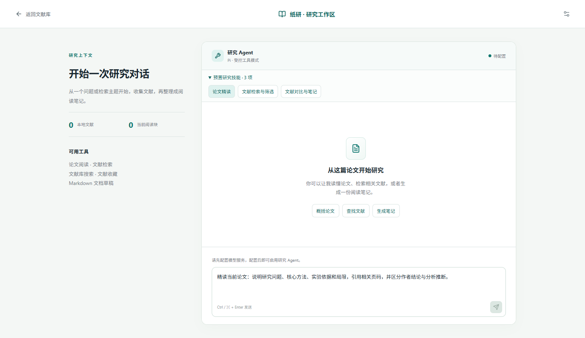

<p align="center">
  
</p>

<h1 align="center">Zhiyan Workbench · 纸研工作台</h1>

<p align="center">
  Read English research papers with Chinese translations, explanations, and academic vocabulary beside the original.
</p>

<p align="center">
  <a href="README.md">简体中文</a> · <strong>English</strong> · <a href="README.ja.md">日本語</a>
</p>

<p align="center">
  <a href="#screenshots">Screenshots</a> · <a href="#getting-started">Getting started</a> · <a href="#data-and-services">Data and services</a> · <a href="CONTRIBUTING.md">Contributing</a>
</p>

Zhiyan Workbench is a desktop paper reader for Chinese-speaking readers of English research. The **original PDF is the reading surface**: layout, figures, and equations stay intact, with reading assistance alongside each paragraph. Originals, reading progress, vocabulary, and analysis caches are persisted locally.

Current version: `0.3.0` · Primary distribution target: `Windows x64` · Built with `Electron / React / TypeScript`

> These language options translate the repository documentation. The application interface and reading assistance currently focus on Chinese.

## Screenshots

### The paper and its explanation, side by side

Double-click a paragraph to start translation, explanation, summary with contextual role, and vocabulary in parallel. For a highlighted sentence, only the selected original text is processed.


<table>
  <tr>
    <td width="50%">
      
      <p><strong>Organize your papers</strong><br>Search, favorites, tags, metadata editing, and preparation progress in one library.</p>
    </td>
    <td width="50%">
      
      <p><strong>Build academic vocabulary</strong><br>Save terms explicitly, keep their source sentences, and track what you have learned.</p>
    </td>
  </tr>
</table>

<sub>These are real desktop interface screenshots made with author-created synthetic papers and simulated model responses. They contain no user papers or credentials. A fresh installation starts with an empty library. See <a href="docs/assets/README.md">asset provenance</a>.</sub>

## Features

| Reading task | Current capability |
| --- | --- |
| Keep the original layout | Continuous scrolling, pages, zoom, and outline navigation; aligned paragraph, figure, and equation regions, including paragraphs spanning pages. Long papers keep their full scroll layout while PDF pages near the viewport load on demand. |
| Understand a paragraph or sentence | Chinese translation, explanation, summary, and contextual role; original-text selection, streaming results, and local caching. |
| Interpret figures and equations | Double-click a figure to start interpretation with its image and context; answers stream directly as Markdown, with math rendering in translations. |
| Learn academic language | Paragraph vocabulary and AI selections; a personal wordbook with meanings, source sentences, and links back to the paper. |
| Research around a paper | Pi-powered conversations across multiple turns; read the current paper, cite pages, search the local library and Crossref, inspect tool progress and paper candidates, and confirm adding paper metadata to the library. |
| Prepare reading notes | Generate Chinese Markdown drafts, preview them, and choose an export location; three bundled workflows cover close reading, literature search and screening, and literature comparison with notes. |
| Manage a personal library | Import, search, favorites, tags, metadata editing, deletion, and saved reading positions. |
| Adjust the reading environment | Switch between light and dark interfaces in the library sidebar or reader toolbar; keep the preference after restart while original PDF pages, figures, and equation images retain their appearance. |

### Research assistant

Open the dedicated research workspace from the library, or select **研究对话** (Research conversation) beside the current paper. Ask follow-up questions, search for related papers, confirm additions to the library, and generate reading notes. Bundled research skills are read on demand. Tool status, results, page citations, and answers appear in one timeline. Scrolling up during a streamed answer preserves your reading position; returning to the bottom or sending a new question resumes following the output.



Literature search currently uses **Crossref's public scholarly metadata**, with coverage determined by that source. Adding a candidate saves metadata; reading its full text still requires importing its PDF and completing MinerU parsing. Documents export as Markdown. Conversations stay on the current page and are not restored after leaving it or restarting. Model context length is limited for long papers.

## Reading workflow


1. **Save the original.** Import a PDF and keep it in the desktop user-data directory.
2. **Prepare the paper.** If MinerU is configured, the PDF is uploaded automatically for parsing. Otherwise it is saved locally until configuration is complete. The library shows upload, queue, parsing, and download stages.
3. **Open the original.** Reading unlocks only after parsed results, assets, and every reading region's coordinates are ready. Failed preparation can be retried from the library.
4. **Request assistance.** Model analysis starts on user action. Import, parsing completion, and restart recovery do not trigger AI analysis. Model failures do not prevent reading an already prepared paper.

The reader first creates lightweight placeholders for the whole paper, then loads the first page and pages near the current viewport. At most three page loads run at once, with the navigation target taking priority. Scrolling or navigating to another page loads it on demand, keeping requests bounded when opening a long paper or rapidly changing pages.

## Getting started

### Run from source

Install Git, **Node.js 24.x**, and npm. Access to this repository is required.

```powershell
git clone https://github.com/yuanshane76-lang/zhiyan-workbench.git
cd zhiyan-workbench
npm ci
npm run desktop:dev
```

Open **服务配置** (Service settings) and configure the two independent services: **Paper parsing** uses your own **MinerU Token**; **Model service** lets you choose **DeepSeek's official service** or **Alibaba Cloud Bailian**, then enter that provider's API key and model. Research conversations use the same model configuration. See the [service setup guide (Chinese)](docs/服务密钥配置.md).

For a web preview, use `npm run dev` and visit `http://127.0.0.1:4173/`. The preview also persists imported PDFs in browser storage; the desktop app stores originals as files in its user-data directory. System credential storage and real service requests require the desktop application.

### Build a Windows ZIP

```powershell
npm run make:win
```

This runs the quality checks and builds a Windows x64 ZIP. The current output is:

```text
out/make/zip/win32/x64/纸研工作台-win32-x64-0.3.0.zip
```

Extract the **entire directory** and launch `Zhiyan.exe`; Node.js is not needed on the recipient's machine. Unsigned builds may trigger a Windows security prompt. Source execution and local builds are the current entry points. ZIP users still configure their own service credentials.

## Data and services

Local-first means originals and reading data are persisted on your machine. Parsing and AI analysis use external services, require a network connection, and may consume quota or incur charges.

| Data or operation | Storage and transmission |
| --- | --- |
| Original PDFs, parsed results, and figure assets | Stored in Electron's user-data directory. With MinerU configured, imported PDFs are automatically sent to MinerU for parsing. |
| Library index, reading position, wordbook, and analysis cache | Stored locally. Caches are identified by content signatures and service configuration. |
| Translation, explanation, vocabulary, figure interpretation, and Q&A | On user action, the necessary passages, context, images, or paper text are sent to the selected model provider. |
| Agent literature searches and note drafts | Search queries are sent to Crossref; the current paper and local paper metadata are supplied to the model as required by the research task. Library additions require confirmation, and drafts are saved after the user chooses a location. |
| Service credentials | Supplied by each user and encrypted in the Electron main process using system secure storage. Saved keys are not returned to the interface in plaintext. |
| Repository and distribution | No bundled default papers, user libraries, parsed caches, or demo credentials. |

Deleting a paper removes its original, parsed assets, and analysis caches. Explicitly collected wordbook terms keep their source sentences; unavailable sources no longer offer navigation.

## Development and validation

```powershell
npm run check
```

This checks common credential formats and the current branch history, runs automated tests, checks TypeScript, and builds the frontend. GitHub's [Quality checks (Windows)](https://github.com/yuanshane76-lang/zhiyan-workbench/actions/workflows/quality.yml) uses the same command without real model or MinerU calls.

For long-canvas changes, also verify that opening a long paper renders only pages near the viewport, page navigation loads the destination on demand, and coordinate hit testing, outline navigation, and zoom anchors keep working.

| Directory | Responsibility |
| --- | --- |
| `src/domain/` | Reading blocks, coordinate hit testing, content signatures, caches, and vocabulary rules |
| `src/services/` | PDF.js, storage access, and service adapters |
| `src/features/`, `src/app/` | Chinese UI, interactions, and status presentation |
| `electron/` | Secure IPC, credentials, document storage, MinerU tasks, and model requests |
| `tests/`, `scripts/` | Automated tests, validation, and build tools |

Use task branches and pull requests. Review staged changes before committing. Desktop interactions, packaging, and live paid-service checks are reported separately; simulated output does not establish live-service success.

## Documentation and support

The detailed contributor and architecture documents are currently in Chinese:

- [Contributing](CONTRIBUTING.md): environment, workflow, commands, and validation scope.
- [Service configuration](docs/服务密钥配置.md): MinerU, DeepSeek, and Bailian.
- [Architecture](docs/架构说明.md): preparation gates, persistence, coordinates, and caches.
- [Research assistant PRD](docs/PRD-研究助手.md) and [technical decisions](docs/技术选型-研究助手.md): Pi conversations, literature search, controlled tools, and note drafts.
- [Collaboration rules](AGENTS.md): product boundaries, file ownership, and security.
- [Private GitHub collaboration](docs/GitHub私有协作配置.md): permissions and branch conventions.
- [Report an issue](https://github.com/yuanshane76-lang/zhiyan-workbench/issues): include reproduction steps, version, and expected behavior; exclude credentials and papers you are not authorized to share.
