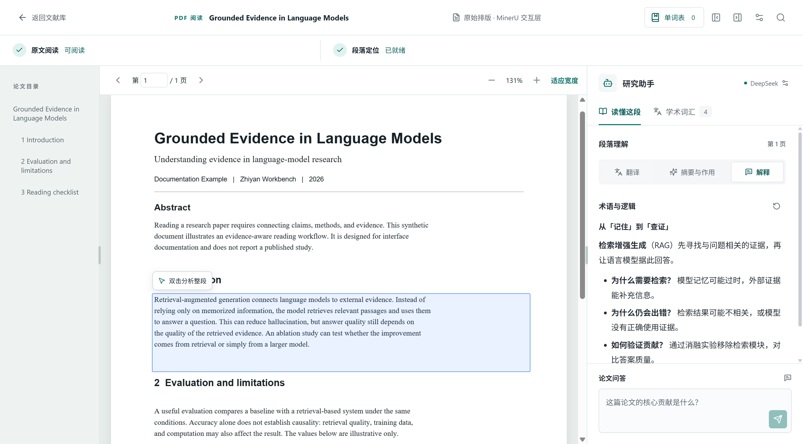
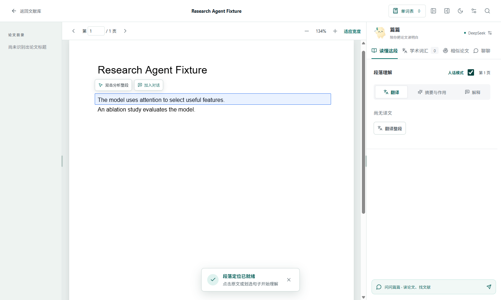
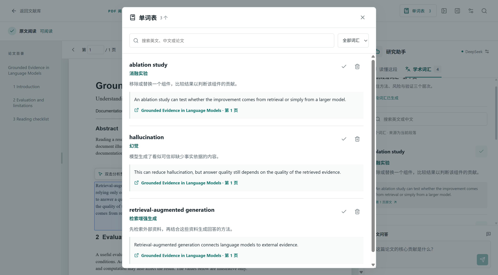
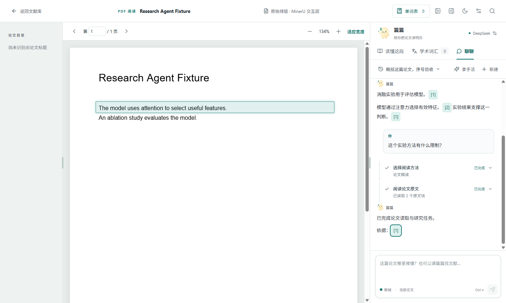
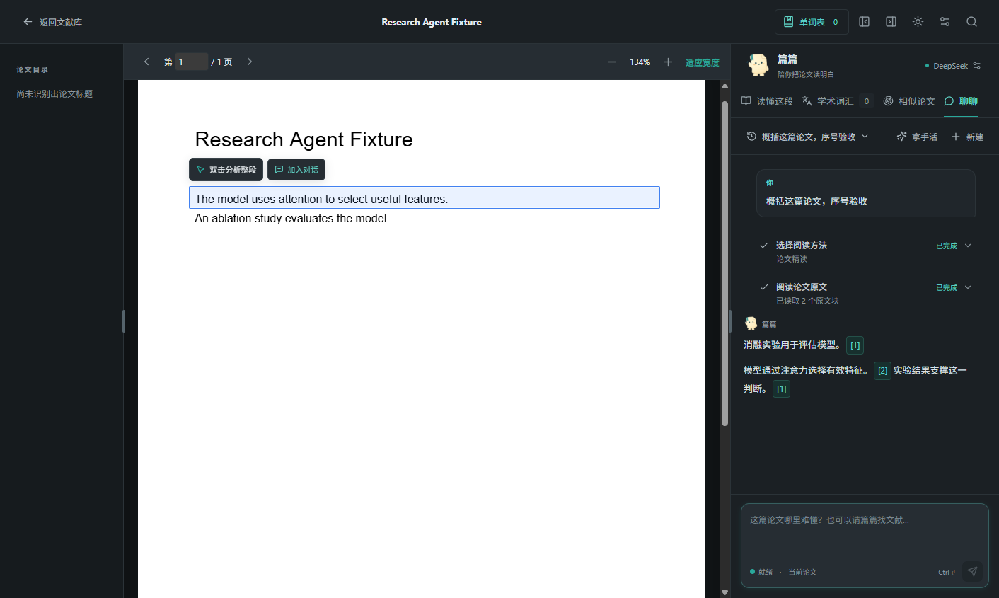
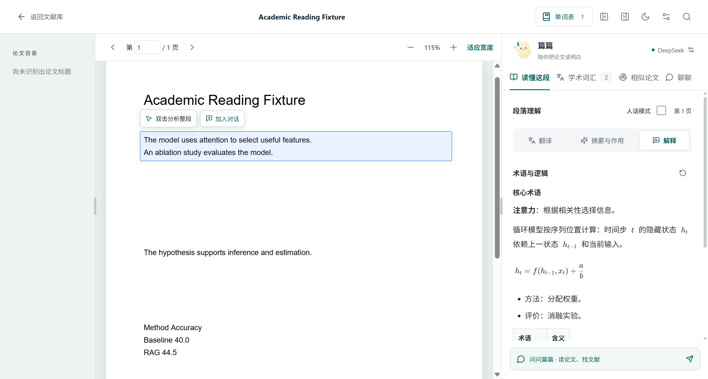
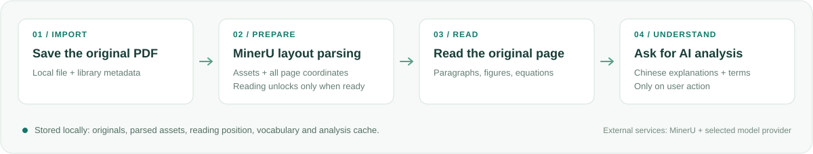

<p align="center">
  
</p>

<h1 align="center">篇篇 · Pianpian</h1>

<p align="center">
  每篇论文，都有个伴。<br>你的 AI 论文阅读伙伴：读懂段落、查找文献、整理阅读笔记。
</p>

<p align="center">
  <strong>简体中文</strong> · <a href="README.en.md">English</a> · <a href="README.ja.md">日本語</a>
</p>

<p align="center">
  <a href="#界面预览">界面预览</a> · <a href="#快速开始">快速开始</a> · <a href="#数据与服务">数据与服务</a> · <a href="CONTRIBUTING.md">参与开发</a>
</p>

篇篇面向阅读英文论文的中文用户。它把**原始 PDF 作为唯一阅读面**，保留排版、图表和公式；在自然段旁提供理解辅助，并把原件、阅读进度、单词表和分析缓存留在本机。

当前开发版本：`0.6.0` · 主要交付平台：`Windows x64` · 技术栈：`Electron / React / TypeScript`

> 三种语言对应仓库介绍文档。应用界面和阅读辅助输出目前以中文为主。

## 近期更新

- **阅读器多标签**：同时打开多篇论文对照阅读，从文献库、知识库星图、研究助手引用或单词表跳转时自动聚焦或新建标签；每篇阅读位置与面板状态独立保留，支持中键/双击关闭与加号新建。
- **演示文稿导入与阅读**：支持 pptx/ppt 走 MinerU 转换，按幻灯片画布复用块坐标还原原始版面；PPT 另存为的 PDF 自动识别；可拖拽框选多段交给篇篇翻译或解释。
- **人话模式全局化**：开关移至助手头部，翻译、解释、词汇、读图表、读公式统一生效，标准与人话缓存互不覆盖。
- **研究助手相似论文兜底**：公开检索不到、来源限流或需要扩展相关工作时，自动降级到 Semantic Scholar 相似论文推荐，候选确认后以元数据入库。
- **论文知识库与深空星图**：按论文列表逐篇提取概念与方法知识条目，跨论文自动聚合成知识页面；化用 Obsidian 的双向链接与反向链接，以深空星图呈现——论文是金色枢纽星群、概念是发光星体、近似概念以星座线相连，支持拖拽排版、名称开关与显示选项（过滤/力度/大小/重置）。每条论述都带原文锚点，点击跳回对应论文原位。
- **文章架构思维导图重做**：不再机械复读标题树——正文按一级章节合并为少数大部分，模型提炼语义标题、论证主线与两级要点树，一次性并发生成整棵导图；架构面板与正文并列显示（占用段落助手位置、可拖宽度），双击段落自动切回，点击要点跳回原文。
- **从对话发现并导入论文**：研究助手可同时检索 arXiv 与 Crossref；确认 arXiv 候选后下载官方 PDF，保存本机并进入 MinerU 解析队列。安装器完成页直接启动应用，保留开始菜单快捷方式。
- **扩展论文检索与阅读辅助**：DeepSeek 服务可调用原生联网搜索与网页读取；阅读器增加 Semantic Scholar 相似论文雷达、人话模式和公式解读。
- **安装与更新**：Windows 安装版可从 GitHub 检查更新、下载并确认重启安装；更新前保存与备份本地阅读数据，ZIP 继续作为手动分发方式。[更新与发布说明](docs/自动更新与发布.md)。

- **你好，我是篇篇**：产品与 AI 阅读伙伴统一命名为「篇篇」，使用真实 gpt-image-2 生成的折角纸片形象。入口是「问问篇篇」，阅读器中可以「聊聊」，段落词汇交给「篇篇选词」。[品牌语言与素材来源](docs/品牌语言.md)。
- **对话界面更轻巧**：历史对话、新建和「拿手活」收进一条工具栏；弹层按需展开，给正文与流式回答留出空间。
- **论文按分组整理**：创建分组后为论文选择归属；编辑窗口中可直接新建并选中分组，不再叠加第二个弹窗。
- **长论文打开更流畅**：PDF 页面按需加载，篇篇对话首次打开时才初始化，Pi 会话在工作线程中运行。
- **工具执行过程更清楚**：紧凑时间线展示执行状态、任务摘要和检索结果；详情可展开，写入文献库仍需确认。
- **回答引用可定位**：点击回答中的原文引用，跳转到对应页面和阅读块。
- **词汇随段落生成**：双击段落并行生成翻译、解释、摘要与作用和 AI 精选词汇；生成前为空态，收藏后保留原句与来源。

## 界面预览

### 全库研究工作区

从独立工作区检索本地文献、发起研究对话，并按需打开论文精读、文献检索与筛选、文献对比与笔记三个预置流程。


### 原文阅读与人话模式

原始 PDF 保持为唯一阅读面。双击自然段后可按需翻译、解释或生成摘要与作用；「人话模式」影响接下来生成的段落内容。





### 文献库与个人单词表

<table>
  <tr>
    <td width="50%">
      
      <p><strong>整理本地文献</strong><br>首次启动保持空库；导入后可搜索、收藏、分组、编辑元数据并查看解析状态。</p>
    </td>
    <td width="50%">
      
      <p><strong>积累学术表达</strong><br>主动收藏段落词汇，记录中文释义、原句和来源；支持搜索、掌握状态与删除。</p>
    </td>
  </tr>
</table>

### Pi 研究助手与原文引用

全库对话与单篇论文「聊聊」分别保存。工具过程、检索结果和回答在同一时间线上；回答中的引用可返回对应阅读块。





### Markdown 与数学公式

阅读辅助的 Markdown 与数学表达式在界面中排版呈现。



<sub>本轮更新并重新生成了文献库、阅读器、单词表、人话模式、Markdown/公式及浅色/深色研究助手截图（2026 年 10 月 21 日）；全库工作区图也用同一验收脚本重新生成，画面与原图一致。截图来自隔离的 Electron 验收环境。论文和词条是合成示例，流式回答由本地模拟响应提供；不含用户论文、真实密钥或真实服务输出。文献库图展示首次启动的空状态。更多素材来源和边界见 <a href="docs/assets/README.md">截图与视觉资产</a>。</sub>

## 功能总览

| 阅读需求 | 当前能力 |
| --- | --- |
| 阅读原始论文 | PDF.js 原样显示 PDF；支持连续滚动、翻页、缩放、目录跳转、阅读位置恢复。长论文按需加载视口附近页面。 |
| 对齐原文结构 | MinerU 解析段落、图表、表格、公式及其坐标；准备完成后才开放阅读，解析进度和失败重试在文献库中呈现。支持跨页段落定位。 |
| 理解段落与选句 | 自然段可分别翻译、解释、总结要点和上下文作用；「人话模式」切换后续段落内容风格。划选句子时只处理选中的原文。 |
| 文章架构导图 | 正文按真实章节合并为大部分，模型提炼语义标题、论证主线与要点树并一次性生成；架构面板与正文并列，支撑点带原文锚点，点击跳回原位。 |
| 论文知识库星图 | 按论文列表逐篇提取概念与方法，跨论文聚合为知识页面，带双向链接与反向链接；深空星图支持拖拽、过滤与力度调节，新论文解析完成后自动汇入。 |
| 读图表和公式 | 图表、表格和公式可单独发起 AI 解读；结合图像或公式原文及相邻上下文，展示结论与适用边界。 |
| 阅读 Markdown 和数学表达式 | 流式回答安全渲染 Markdown；翻译与解释中的 LaTeX 数学表达式使用公式排版。 |
| 学术词汇学习 | 按段落生成或手动生成有原文依据的学术词汇；可收藏中文释义、定义、例句和文献来源，并搜索、标记掌握或移除。 |
| 本地文献检索 | 在本机文献库按标题、作者及已解析正文搜索；返回匹配段落片段与原文定位，篇篇可据此归纳。 |
| 公开论文发现 | 并行检索 arXiv 与 Crossref。DeepSeek 服务还可调用原生联网搜索与读取网页；阅读器可使用 Semantic Scholar 相似论文雷达发现元数据候选。覆盖范围、可达性和限额取决于各服务。 |
| 论文下载与入库 | 仅在用户确认后下载并校验 arXiv 官方 PDF、保存本机；已配置 MinerU 时启动解析，尚未配置则等待配置后继续。Crossref 或 Semantic Scholar 元数据不会被误称为已下载全文。 |
| 研究助手 | Pi 支持全库或单篇多轮对话、读取论文、工具状态展示和可点击原文引用。全库与单篇对话历史分别保存，可恢复、搜索、重命名和删除。 |
| 研究流程与笔记 | 内置论文精读、文献检索与筛选、文献对比与笔记三个流程；生成中文 Markdown 草稿，预览后由用户选择保存位置。 |
| 文献整理 | 导入 PDF，搜索、收藏、建立分组、编辑元数据、删除论文或分组；保留原件、解析资产与阅读进度。 |
| 阅读偏好 | 浅色与深色界面切换并记住选择；原始 PDF、图表和公式图像仍保持原貌。 |
| 本地数据与密钥 | PDF 原件、文献库、阅读位置、单词表和分析缓存保存在本机。模型、MinerU 与可选 Semantic Scholar 密钥由 Electron 主进程接入系统安全存储，不放入前端状态或仓库。 |

### 和篇篇聊聊

从文献库点击「问问篇篇」，或在当前论文旁切换到「聊聊」。可以连续提问、检索相关论文、确认加入文献库，再生成阅读笔记。「拿手活」里有论文精读、文献检索与筛选、文献对比与笔记三个预置阅读流程，按需读取；工具状态、结果、序号引用和回答在同一条时间线上呈现。流式输出期间向上阅读历史消息会保留当前位置，回到底部或发送新问题后恢复跟随。

回答中的原文引用只显示 `[1]`、`[2]` 这样的序号，不展示来源页码、摘录或重复引用列表。每条回答按首次引用顺序编号，同一原文块复用序号；点击即定位并短暂高亮对应自然段。引用来自工具实际读取的稳定阅读块，不能仅凭页码猜测位置。「聊聊」页签首次访问才启动 Pi，会话初始化在工作线程中完成，打开 PDF 时不启动隐藏的研究会话。

<sub>引用预览来自隔离桌面的合成论文与模拟流式响应，用于展示界面；不包含用户论文、密钥或真实服务输出。来源见 <a href="docs/assets/README.md">截图与视觉资产</a>。</sub>

可以连续发送三个问题，完成一次研究流程：

1. “概括这篇论文的方法和主要结论，并附上原文引用。”
2. “查找两篇相关文献，列出标题、年份和 DOI。”
3. “结合论文与检索结果，生成一份中文阅读笔记草稿。”

论文检索工具并行使用 **arXiv 与 Crossref**。配置 DeepSeek 官方服务时，研究助手还可使用 DeepSeek 原生 `search_web` 和 `fetch_web_page`；阅读器的相似论文雷达使用 Semantic Scholar 公开元数据接口。它们是不同入口，结果覆盖、可达性、限额和全文可下载性均由对应来源决定，不能视为穷尽全网。加入文献库前须由用户确认：arXiv 候选会下载并校验官方 PDF；Crossref 与 Semantic Scholar 候选只保存元数据，不代表已经取得 PDF 或全文。全库与单篇对话分别保存在本机，支持恢复、搜索、重命名和删除；超长论文的模型上下文有长度限制。

## 从导入到阅读



1. **保存原件**：导入本地 PDF，原始文件保存在当前桌面用户目录。
2. **准备阅读**：已配置 MinerU 时自动上传解析；未配置时先保存原件并引导配置，配置完成后继续。文献库显示上传、排队、解析和结果下载等阶段。
3. **打开原文**：解析结果、图表资源和所有阅读块坐标准备完成后，才解锁阅读。失败时在文献库重试。
4. **按需理解**：主动操作才调用模型。导入、解析完成与重启恢复不会自动发起 AI 分析；模型失败不影响已就绪论文的原文阅读。

阅读器会先建立整篇论文的轻量页面占位，再加载首屏和当前视口附近的页面。最多同时加载三个页面，跳转目标优先；滚动或跳转到新页面时才继续加载对应 PDF 页面，避免长论文打开和快速翻页时累积大量请求。

## 快速开始

### 从源码运行

准备 Git、**Node.js 24.x** 和 npm，并确保有此仓库的访问权限。

```powershell
git clone https://github.com/yuanshane76-lang/pianpian.git
cd pianpian
npm ci
npm run desktop:dev
```

桌面窗口打开后，在「服务配置」中分别设置两个并列服务：**论文解析服务**使用自己的 **MinerU Token**；**模型服务**选择 **DeepSeek 官方**或**阿里云百炼**，填写对应密钥及模型。篇篇对话使用同一份模型配置；如需相似论文雷达，可按需配置 Semantic Scholar。申请和配置步骤见 [服务密钥配置](docs/服务密钥配置.md)。

仅预览网页可运行 `npm run dev`，打开 `http://127.0.0.1:4173/`。网页预览也会将导入的 PDF 保存在浏览器存储中；桌面版将原件保存为用户数据目录中的文件。系统密钥存储和真实服务请求需要桌面端。

### 构建 Windows 安装包与压缩包

```powershell
npm run make:win
```

命令先运行质量检查，再生成 Windows x64 安装版、ZIP 和签名更新元数据。当前版本输出：

```text
out/installer/Pianpian-Setup-0.6.0-x64.exe
out/installer/Pianpian-0.6.0-x64.zip
```

安装版可在文献库底部或桌面菜单点击「检查更新」，下载后确认重启安装；更新前保存与备份关键数据。旧 ZIP 用户需手动安装一次，沿用原有数据目录。ZIP 解压**完整目录**后打开 `Pianpian.exe`，无需另装 Node.js。暂未使用商业代码签名证书，首次运行可能出现 Windows 安全提示。构建需要仓库外的发布签名私钥，详见 [自动更新与发布](docs/自动更新与发布.md)。

## 数据与服务

“本地优先”表示原件和阅读数据在本机持久化。解析与 AI 分析使用外部服务，需联网，并可能消耗账号额度或产生费用。

| 数据或操作 | 存储与发送范围 |
| --- | --- |
| 原始 PDF、解析结果、图表资源 | 保存在 Electron 用户数据目录；已配置 MinerU 时，导入的 PDF 会自动发送到 MinerU 解析。 |
| 文献索引、阅读位置、单词表、分析缓存 | 在本机保存；缓存按内容签名和服务配置区分。 |
| 翻译、解释、词汇、图表解读和问答 | 用户主动发起后，将所需段落、上下文、图像或正文发送给选定的模型服务商。 |
| 研究助手与公开检索 | 论文检索词发送到 arXiv 与 Crossref；DeepSeek 原生联网搜索和网页读取由 DeepSeek 服务处理；相似论文雷达向 Semantic Scholar 请求公开元数据。当前论文和本地文献元数据按研究任务提供给选定模型。 |
| 论文下载与草稿导出 | 仅在用户确认后下载 arXiv 官方 PDF；Crossref、Semantic Scholar 候选只保存元数据。Markdown 草稿需用户预览并选择路径后保存。 |
| 服务密钥 | 由每位用户自行配置，通过 Electron 主进程使用系统安全存储加密；不回传已保存的明文密钥。 |
| 仓库与交付包 | 不包含默认论文、用户文献库、解析缓存或演示密钥。 |

删除文献会移除对应原件、解析资产和分析缓存；已主动收藏到单词表的词汇仍保留原句，来源不可用时不再提供跳转。

## 开发与验证

```powershell
npm run check
```

该命令检查常见凭据格式及当前分支历史，运行自动测试、TypeScript 检查与前端构建。GitHub 的 [Quality checks (Windows)](https://github.com/yuanshane76-lang/pianpian/actions/workflows/quality.yml) 使用同一入口，不调用真实模型或 MinerU。

长画布改动还应验证：长论文启动时只渲染视口邻近页面，页码跳转后按需加载目标页，且原有坐标命中、目录定位和缩放锚点不回归。

### 验证记录

2026 年 10 月 16 日，篇篇品牌与对话界面更新在 Windows 本机完成以下验证：

| 验证范围 | 结果 |
| --- | --- |
| 自动检查 | `npm run check` 通过：61 个测试文件、488 个测试，凭据检查、TypeScript 和生产构建通过。 |
| 浅色与深色桌面交互 | 真实 Electron 与 Pi SDK，使用隔离用户目录、合成论文和本地模拟 SSE；验证多轮工具执行、确认与取消、笔记导出、流式滚动、引用定位、历史恢复、弹层键盘交互和分组编辑。 |
| Windows ZIP | 构建并解压 `篇篇-win32-x64-0.3.0.zip`，启动 `Pianpian.exe`；验证篇篇标题与形象、内置 Pi 与三个阅读流程、缺少双服务密钥时的必填引导、分步保存与主题保留。 |
| 外部服务 | 本次桌面回归与压缩包验收未调用真实模型或 MinerU；品牌素材单独使用 gpt-image-2 生成。 |

本次改名继续沿用原有本机数据目录，保留用户文献库与服务配置。打包验收不包含已签名安装程序或自动更新流程。

以下为 2026 年 10 月 14 日的历史性能与真实服务记录，不表示本次重新执行了付费服务验收。

2026 年 10 月 14 日，功能提交 `f838be9` 在 Windows 本机完成以下验证：

| 验证范围 | 结果 |
| --- | --- |
| 自动检查 | `npm run check` 通过：56 个测试文件、428 个测试，凭据检查、TypeScript 和生产构建通过。 |
| 合成桌面回归 | 真实 Pi SDK 配合本地模拟 SSE，验证技能读取、工具确认与停止、文档导出、流式滚动和原文引用跳转；未调用外部服务。 |
| 真实长论文 | 在临时用户目录中打开 DEER（45 页）和 FINDEEPRESEARCH（25 页），完成冷启动、尾页跳转、缩放和按需画布检查。 |
| 真实模型与检索 | DeepSeek 四项段落流式结果、三轮 Pi 对话、原文引用跳转、公开文献检索、Markdown 草稿，以及小窗口明暗主题检查通过。 |

真实服务验收中，两篇论文首屏分别为 543ms 和 553ms；每次打开只读取一次原始 PDF，未记录到超过 100ms 的主进程心跳间隔，窗口“未响应”事件为 0。这是该次本机样本记录，性能会受论文、硬件和运行环境影响。

10 月 14 日未完成“重新上传 → MinerU 重新解析 → 首次阅读”的额外验收，不能将已解析论文的结果视为该链路通过；10 月 16 日也未补做这项真实服务验收。真实论文、服务配置和原始验收截图留在被 Git 忽略的本机目录。

### 复现桌面验收

已在本机导入并解析 DEER（45 页）和 FINDEEPRESEARCH（25 页）时，可运行真实论文性能验收。脚本复制论文到临时用户目录，记录首屏、主进程停顿、未响应事件和截图，不改正式文献库：

```powershell
npm run test:reader-performance:e2e
# 显式使用本机已配置的模型，验证段落四路生成与三轮真实工具对话
node scripts/reader-performance-e2e.cjs --live-ai
# 额外的重解析验收入口，本次尚未验收通过；会使用 MinerU 额度
node scripts/reader-performance-e2e.cjs --live-ai --reparse
```

报告与截图只写入被 Git 忽略的 `out/reader-performance-acceptance/` 或 `out/reader-live-acceptance/`。合成桌面回归分别使用 `npm run test:research-agent:e2e`、`npm run test:paragraph-vocabulary:e2e`，不请求外部服务。

| 目录 | 职责 |
| --- | --- |
| `src/domain/` | 阅读块、坐标命中、内容签名、缓存与词汇等业务规则 |
| `src/services/` | PDF.js、存储访问和服务适配 |
| `src/features/`、`src/app/` | 中文界面、交互和状态呈现 |
| `electron/` | 安全 IPC、密钥、文档存储、MinerU 任务与模型请求 |
| `tests/`、`scripts/` | 自动测试、验证和构建工具 |

协作采用任务分支与 PR。提交前检查暂存差异，真实桌面交互、打包和付费服务验证单独记录，不能用模拟响应替代真实服务结论。

## 进一步阅读

- [参与开发](CONTRIBUTING.md)：环境、协作流程、命令与验收边界。
- [服务密钥配置](docs/服务密钥配置.md)：MinerU、DeepSeek 与百炼的配置。
- [架构说明](docs/架构说明.md)：阅读门禁、持久化、坐标和缓存规则。
- [研究助手 PRD](docs/PRD-研究助手.md)与[技术选型](docs/技术选型-研究助手.md)：Pi 会话、文献检索、受控工具和笔记草稿。
- [协作约定](AGENTS.md)：产品目标、文件归属与安全要求。
- [GitHub 私有协作配置](docs/GitHub私有协作配置.md)：仓库权限与分支规则。
- [提交问题](https://github.com/yuanshane76-lang/pianpian/issues)：请描述复现步骤、版本和预期结果，勿附密钥或未获授权的论文。
