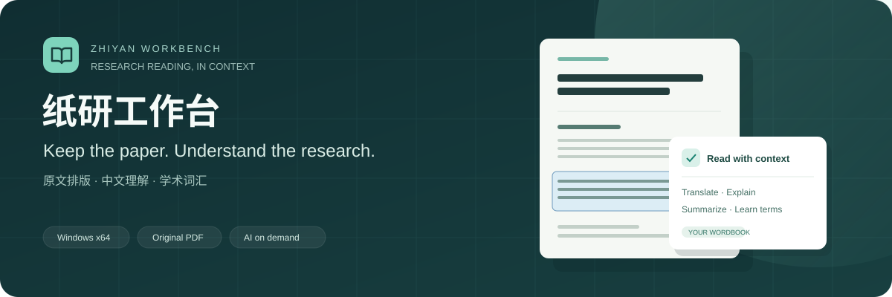

<p align="center">
  
</p>

<h1 align="center">纸研工作台 · Zhiyan Workbench</h1>

<p align="center">
  在英文论文原文旁，获得中文翻译、解释和学术词汇。
</p>

<p align="center">
  <strong>简体中文</strong> · <a href="README.en.md">English</a> · <a href="README.ja.md">日本語</a>
</p>

<p align="center">
  <a href="#界面预览">界面预览</a> · <a href="#快速开始">快速开始</a> · <a href="#数据与服务">数据与服务</a> · <a href="CONTRIBUTING.md">参与开发</a>
</p>

纸研工作台面向阅读英文论文的中文用户。它把**原始 PDF 作为唯一阅读面**，保留排版、图表和公式；在自然段旁提供理解辅助，并把原件、阅读进度、单词表和分析缓存留在本机。

当前版本：`0.3.0` · 主要交付平台：`Windows x64` · 技术栈：`Electron / React / TypeScript`

> 三种语言对应仓库介绍文档。应用界面和阅读辅助输出目前以中文为主。

## 界面预览

### 原文与理解并排

双击自然段，并行生成译文、解释、摘要与作用、学术词汇。划选句子时，只处理实际选中的原文。


<table>
  <tr>
    <td width="50%">
      
      <p><strong>管理文献</strong><br>搜索、收藏、标签筛选与元数据编辑；解析进度在文献库中呈现。</p>
    </td>
    <td width="50%">
      
      <p><strong>积累学术词汇</strong><br>主动收藏词汇，保留原句与论文来源，支持搜索和掌握状态。</p>
    </td>
  </tr>
</table>

<sub>以上为真实桌面界面的演示截图，使用专门编写的合成论文和模拟模型响应，不包含用户论文或密钥。应用首次启动时文献库为空。素材说明见 <a href="docs/assets/README.md">截图与视觉资产</a>。</sub>

## 能做什么

| 阅读需求 | 当前能力 |
| --- | --- |
| 保留论文原貌 | 连续滚动、翻页、缩放、目录跳转；段落、图表和公式的识别区域与 PDF 对齐，支持跨页自然段。 |
| 读懂一段或一句 | 自然段翻译与解释；摘要和上下文作用；实际原文划选；流式结果与本地缓存。 |
| 看懂图表与公式 | 按需解读选中的图表，结合原图和上下文；译文中的数学表达式使用公式渲染。 |
| 学习学术表达 | 本段词汇识别与 AI 精选；个人单词表保存释义、原句和来源，可回到原文。 |
| 围绕论文提问 | 基于提供给模型的论文正文进行中文问答。超长论文的上下文有长度限制。 |
| 整理个人文献库 | 导入、搜索、收藏、标签筛选、信息编辑与删除；保存原件和阅读位置。 |

## 从导入到阅读


1. **保存原件**：导入本地 PDF，原始文件保存在当前桌面用户目录。
2. **准备阅读**：已配置 MinerU 时自动上传解析；未配置时先保存原件并引导配置。文献库显示上传、排队、解析和结果下载等阶段。
3. **打开原文**：解析结果、图表资源和所有阅读块坐标准备完成后，才解锁阅读。失败时在文献库重试。
4. **按需理解**：主动操作才调用模型。导入、解析完成与重启恢复不会自动发起 AI 分析；模型失败不影响已就绪论文的原文阅读。

## 快速开始

### 从源码运行

准备 Git、**Node.js 24.x** 和 npm，并确保有此仓库的访问权限。

```powershell
git clone https://github.com/yuanshane76-lang/zhiyan-workbench.git
cd zhiyan-workbench
npm ci
npm run desktop:dev
```

桌面窗口打开后，在「服务配置」中填写自己的 **MinerU Token**；使用 AI 时再配置 **DeepSeek 官方**或**阿里云百炼**密钥及模型。申请和配置步骤见 [服务密钥配置](docs/服务密钥配置.md)。

仅预览网页可运行 `npm run dev`，打开 `http://127.0.0.1:4173/`。网页预览也会将导入的 PDF 保存在浏览器存储中；桌面版将原件保存为用户数据目录中的文件。系统密钥存储和真实服务请求需要桌面端。

### 构建 Windows 压缩包

```powershell
npm run make:win
```

命令先运行质量检查，再生成 Windows x64 ZIP。当前版本输出：

```text
out/make/zip/win32/x64/纸研工作台-win32-x64-0.3.0.zip
```

解压**完整目录**后打开 `Zhiyan.exe`，无需另装 Node.js。未签名构建可能出现 Windows 安全提示。仓库目前以源码运行和本地构建为入口；压缩包使用者同样需要配置自己的服务密钥。

## 数据与服务

“本地优先”表示原件和阅读数据在本机持久化。解析与 AI 分析使用外部服务，需联网，并可能消耗账号额度或产生费用。

| 数据或操作 | 存储与发送范围 |
| --- | --- |
| 原始 PDF、解析结果、图表资源 | 保存在 Electron 用户数据目录；已配置 MinerU 时，导入的 PDF 会自动发送到 MinerU 解析。 |
| 文献索引、阅读位置、单词表、分析缓存 | 在本机保存；缓存按内容签名和服务配置区分。 |
| 翻译、解释、词汇、图表解读和问答 | 用户主动发起后，将所需段落、上下文、图像或正文发送给选定的模型服务商。 |
| 服务密钥 | 由每位用户自行配置，通过 Electron 主进程使用系统安全存储加密；不回传已保存的明文密钥。 |
| 仓库与交付包 | 不包含默认论文、用户文献库、解析缓存或演示密钥。 |

删除文献会移除对应原件、解析资产和分析缓存；已主动收藏到单词表的词汇仍保留原句，来源不可用时不再提供跳转。

## 开发与验证

```powershell
npm run check
```

该命令检查常见凭据格式及当前分支历史，运行自动测试、TypeScript 检查与前端构建。GitHub 的 [Quality checks (Windows)](https://github.com/yuanshane76-lang/zhiyan-workbench/actions/workflows/quality.yml) 使用同一入口，不调用真实模型或 MinerU。

| 目录 | 职责 |
| --- | --- |
| `src/domain/` | 阅读块、坐标命中、内容签名、缓存与词汇等业务规则 |
| `src/services/` | PDF.js、存储访问和服务适配 |
| `src/features/`、`src/app/` | 中文界面、交互和状态呈现 |
| `electron/` | 安全 IPC、密钥、文档存储、MinerU 任务与模型请求 |
| `tests/`、`scripts/` | 自动测试、验证和构建工具 |

协作采用任务分支与 PR。提交前检查暂存差异，真实桌面交互、打包和付费服务验证单独记录，不能用模拟响应替代真实服务结论。

## 进一步阅读

- [参与开发](CONTRIBUTING.md)：环境、协作流程、命令与验收边界。
- [服务密钥配置](docs/服务密钥配置.md)：MinerU、DeepSeek 与百炼的配置。
- [架构说明](docs/架构说明.md)：阅读门禁、持久化、坐标和缓存规则。
- [协作约定](AGENTS.md)：产品目标、文件归属与安全要求。
- [GitHub 私有协作配置](docs/GitHub私有协作配置.md)：仓库权限与分支规则。
- [提交问题](https://github.com/yuanshane76-lang/zhiyan-workbench/issues)：请描述复现步骤、版本和预期结果，勿附密钥或未获授权的论文。
