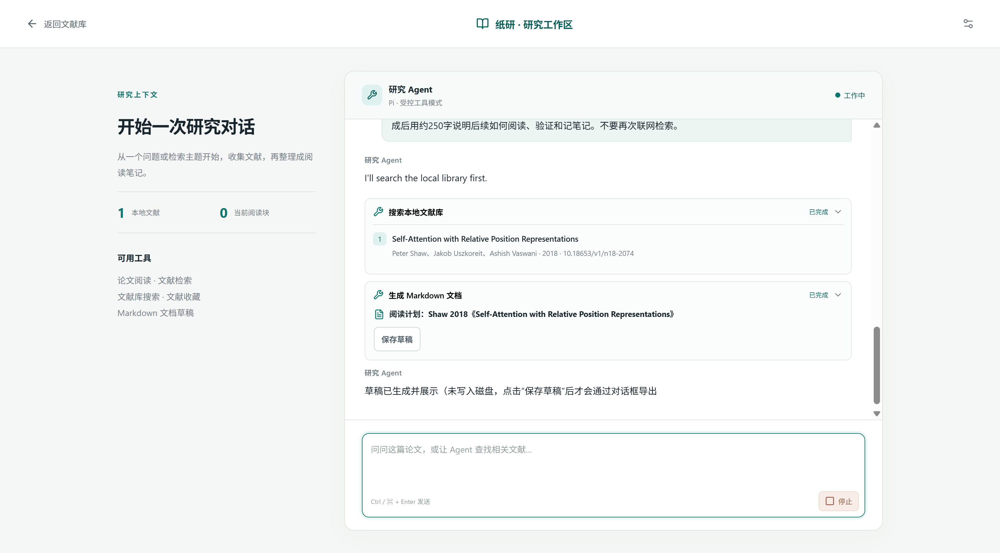

# 研究助手验收记录

日期：2026-10-12
任务分支：`feat/pi-research-assistant`
对应需求：[PRD](./PRD-研究助手.md)、[技术选型](./技术选型-研究助手.md)

## 交付范围

采用 Pi SDK 1.1.0，参考 Picode 的 Electron/React 交互与事件桥接方式，在纸研现有界面中实现流式多轮对话、工具时间线、当前论文页码引用、文献检索、确认入库和 Markdown 草稿保存。

原有阅读助手界面见 [基线截图](./assets/reader.png)。新增研究工作区的真实工具链与流式状态如下：



产品只注册五个工具：`read_current_paper`、`search_library`、`search_literature`、`add_paper_to_library`、`create_document`。没有演示模型、预置论文、模板回复或模拟搜索分支；测试脚本中的合成 SSE 与元数据响应不进入安装包。

DeepSeek 和 MinerU 已通过应用设置边界配置，密钥由 Electron 系统安全存储加密保存。验收记录、截图、Git 和 ZIP 均不包含密钥。

## 自动化与审查

| 范围 | 实际结果 |
| --- | --- |
| `npm run check` | 50 个测试文件、368 项测试通过；凭据和分支历史检查、TypeScript、前端构建通过 |
| `node scripts/pi-agent-smoke.cjs` | 真实 Pi SDK + 本地合成 SSE，4 次模型请求，五个产品工具 allowlist 验证通过 |
| `node scripts/research-agent-e2e.cjs` | 隔离 Electron + 真实 Pi SDK + 合成服务，8 项桌面回归通过，0 外部请求、0 页面错误 |
| 聚焦代码复核 | 三项审批/事件边界问题修复后复核通过，无遗留 Critical / Important |
| `git diff --check` | 通过 |

8 项桌面回归覆盖：工具链呈现、确认入库、拒绝入库、停止待确认工具、Markdown 保存、1000px 无横向溢出、纯元数据条目不能打开阅读、原始 PDF 中两轮对话与稳定阅读块引用跳转。

追加的行为回归覆盖：审批保留请求尚未返回时结束或切换会话不得写入；DOI 链接补齐和非法链接拒绝；500 条较大文献元数据检索返回数量和截断标识；协议异常显示失败工具卡并停止本轮。复核补充检查了停止、错误和卸载期间的晚到审批，旧写入均为 0。

后续真实对话还暴露了本地查库只支持整句匹配的问题。已增加作者、年份与不连续标题关键词组合的回归测试，先确认失败再修复为组合匹配；`Shaw 2018 Self-Attention with Relative Position Representations` 和 `Self-Attention Relative Position` 均能找到已入库记录，错误年份不命中。原问题的脱敏查询证据为 `out/research-agent-live/query-regression-report.json`。

## 真实服务视觉验收

真实服务验收与合成服务回归分别记录。下述真实链路没有替换模型、检索或 MinerU 响应。

### 论文阅读三轮

测试论文：公开论文 *Attention Is All You Need*，arXiv `1706.03762`，本次取得 15 页 PDF。

1. 通过正常导入入口保存原始 PDF，真实 MinerU 完成解析、资产持久化和坐标准备，得到 173 个阅读块后解锁阅读。
2. 第一轮：读取当前论文并检索关联文献，界面显示读取与检索工具卡，模型给出中文解释和引用。
3. 第二轮：请求加入推荐论文，出现元数据确认卡；确认后写入本地文献库，Agent 收到实际写入结果继续回答。
4. 第三轮：继续读取论文不同页的内容，生成中文阅读笔记，通过 Windows 原生保存对话框保存 UTF-8 Markdown。

结果：3 条用户问题、3 个回合结束事件、5,635 个文本增量事件、11 个工具完成事件、0 Agent 错误。导出文件 15,592 字节，内容区分已读原文与关联论文尚待核实的信息。

本机证据位于 `out/research-agent-live/`：

- `01-import.png`：真实解析阶段与进度。
- `02-reader-ready.png`：原始 PDF 解锁阅读。
- `03-turn1-toolchain.png`、`05-turn2-complete.png`：工具过程与后续回答。
- `07-turn3-document.png`：原始 PDF 与文档草稿卡。
- `reading-note.md`、`live-report.json`：导出文档与脱敏事件统计。

`06-turn3-streaming.png` 的文件名沿用采集时命名，但截图实际已接近回合结束，不能单独作为流式中证据；流式中的明确画面使用下述打包版截图。

### Windows 打包版三轮

从 Windows ZIP 解压后启动 `Zhiyan.exe`，实际 `app.isPackaged` 为真。确认 Pi SDK 及生产依赖能在 asar 中加载，并使用系统安全存储中的配置完成真实对话：

1. 检索 Transformer 相对位置相关论文，显示执行中工具卡和流式回答。
2. 请求加入推荐论文 *Self-Attention with Relative Position Representations*，用户确认后实际入库。
3. 查询刚加入的本地条目，生成基于元数据的阅读计划，原生保存后显示“已保存”。

该轮结果：3 个回合完整结束、812 个文本增量事件、8 个工具结束事件。其中 7 次成功，1 次 Crossref HTTP 429 正确显示为工具失败；模型后续继续检索并完成会话，0 Agent 错误。导出文件 674 字节，明确标注未取得全文。

证据：`08-packaged-ready.png`、`09-packaged-tool-running.png`、`10-packaged-streaming.png`、`11-packaged-turn1-complete.png`、`12-packaged-turn2-approval.png`、`13-packaged-turn3-document.png`、`14-packaged-save-success.png`、`packaged-reading-plan.md`、`packaged-report.json`。

上述证据与真实用户数据不入 Git。验收加入的文献记录按测试记录 ID 单独清理，服务配置保留。

## 最终修复后的打包回归

审批生命周期、URL 规范化、输出预算和组合关键词匹配修复后，重新生成 Windows ZIP 并解压启动，完成最后一组三轮真实对话：

1. `search_literature`：检索 Shaw 2018 论文，返回真实 Crossref 题录。
2. `add_paper_to_library`：显示确认卡，确认后持久化文献条目。
3. `search_library`：用完整作者、年份和标题组合查询，命中刚加入的 1 条记录；随后 `create_document` 生成阅读计划，通过原生对话框保存。

最终结果：3 条用户问题、3 个回合结束、565 个文本增量、4 个成功工具结束事件，0 Agent 错误、0 页面错误。导出 Markdown 为 568 字节，UI 显示已保存。实际模型在第三轮生成了一句英文工具前说明，正文和工具界面为中文；当前通过系统提示优先约束中文，没有对模型文本做强制翻译。

截图为 `19-accepted-tool-running.png`、`20-accepted-turn1.png`、`21-accepted-approval.png`、`22-accepted-streaming.png`、`23-accepted-complete.png`、`24-accepted-saved.png`；导出文档为 `accepted-reading-plan.md`，脱敏统计为 `accepted-report.json`。其中 `22-accepted-streaming.png` 明确同时显示“工作中”、停止按钮、已完成工具与尚未结束的回答。

最终 ZIP：`out/make/zip/win32/x64/纸研工作台-win32-x64-0.3.0.zip`。

SHA-256：

```text
9F82496652D44AE49D099A93533B6CD96C8C60401475923163FCD1B53C50F9A2
```

已逐文件比较解压包 asar 内的 Electron 模块和前端构建文件与当前工作区，内容一致。安装包不存在测试脚本、测试数据、输出目录、`.env` 或用户加密设置文件。仅清理本次实际加入记录的 ID，最终文献库为空，DeepSeek 与 MinerU 配置继续保留。

## 已知范围与未验证项

- 文献搜索当前使用 Crossref 公开元数据，覆盖范围依赖来源，不能视为全网穷尽搜索；未实现全文自动下载。
- 入库的是待导入全文的文献条目。没有原始 PDF 和完整可靠坐标时，不能打开全文阅读。
- 文档导出当前为 Markdown；Word、独立读书笔记数据与第三方 Skill/MCP 装载尚未实现。
- 会话历史仅在当前页面内存中保留，退出页面或重启不恢复。
- Windows ZIP 已按本记录验证；签名安装器、其他操作系统、跨机器密钥迁移未验证。
- 前端构建仍有大于 500 kB 的分包体积提示；本次桌面交互未出现因此导致的失败，尚未进行专门的启动性能基准。
