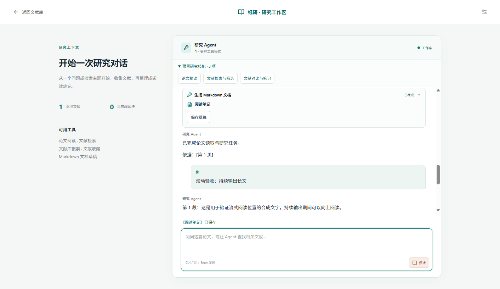

# 预置研究技能与流式滚动验收

日期：2026-10-12

分支：`feat/bundled-research-skills`，基于已提交的 Pi 功能 `9f38a65`。任务使用独立 worktree；正式工作区和原 Pi 工作区的其他任务修改未纳入。

## 结果

- 流式内容按动画帧合并滚动，关闭平滑滚动与浏览器滚动锚定。用户向上移动 40px 后持续输出保持阅读位置；回到底部或发送新问题恢复跟随。
- 预置论文精读、文献检索与筛选、文献对比与笔记三个标准 Skill。清单只有名称、中文标题和入口问题，流程正文只维护在 `SKILL.md`。
- Pi 收到技能摘要，通过 `read_research_skill` 按名称读取完整正文；六个产品工具均通过真实 Pi SDK 的本地合成模型工具循环。
- 未配置密钥也能浏览技能入口；配置完成后才创建模型会话。技能读取只访问清单登记入口，不扫描个人目录，拒绝目录链接和未登记名称。
- Forge 将清单、三个 Skill 和读取模块收入 `app.asar`；未将测试、用户文献、密钥或测试脚本打入应用。

## 验证范围

| 验证 | 结果 |
| --- | --- |
| 修复前回归 | 滚动跟随、技能协议/工具/界面/打包支持测试失败；小幅上滚、未登记目录与 junction、未配置模型会话测试分别先失败后修复 |
| `npm run check` | 通过，51 个测试文件、379 项测试；凭据及分支历史检查、TypeScript、前端构建通过 |
| Skill 格式 | 三个 `quick_validate.py` 校验通过，Pi 标准技能加载诊断为空 |
| 真实 Pi SDK 冒烟 | 通过，5 次本地合成 SSE 请求；摘要先出现、正文按需进入后续模型上下文；无外部请求 |
| 隔离 Electron | 通过，10 项检查；120 段持续输出、40px 上滚保持、恢复跟随、1000px 窗口、确认/拒绝/停止、Markdown 导出与原始 PDF 引用跳转 |
| Windows ZIP | 通过，重新构建、解压；检查完整 Skill 资源；以已打包 Electron 和 `app.asar` 执行 Pi 冒烟；隔离空用户目录启动中文技能入口 |
| 独立代码复审 | 首轮两项 P2 已修复并补回归；收尾复审无合入阻断项，文档工具数量已统一 |
| 真实模型、Crossref、MinerU 服务 | 未验证；本次仅使用本地合成模型、合成元数据与合成 PDF，不产生真实服务费用 |

现有 Vite 大 chunk 提示及 Forge 的 `fs.rmdir` 弃用提示未阻止构建或打包。

## 界面和交互

点击“预置研究技能”展开入口；点击具体技能填入对应研究问题，用户发送后模型按任务读取技能。未配置模型时显示中文配置提示。

持续输出期间向上阅读，内容继续增长而视口保持；向下回到底部恢复跟随。

## 压缩包

产物：`out/make/zip/win32/x64/纸研工作台-win32-x64-0.3.0.zip`

大小：219117688 字节。

SHA-256：`6EEF1861346FF11A22BCAB86F08E614D20B15EB4CE1257EA896DA9BAEB3977FC`

预置技能不会新增公开文献来源，也不会让检索元数据变成已读取全文；Crossref 限流适配器的自动退避与缓存不在本次实现范围内。
